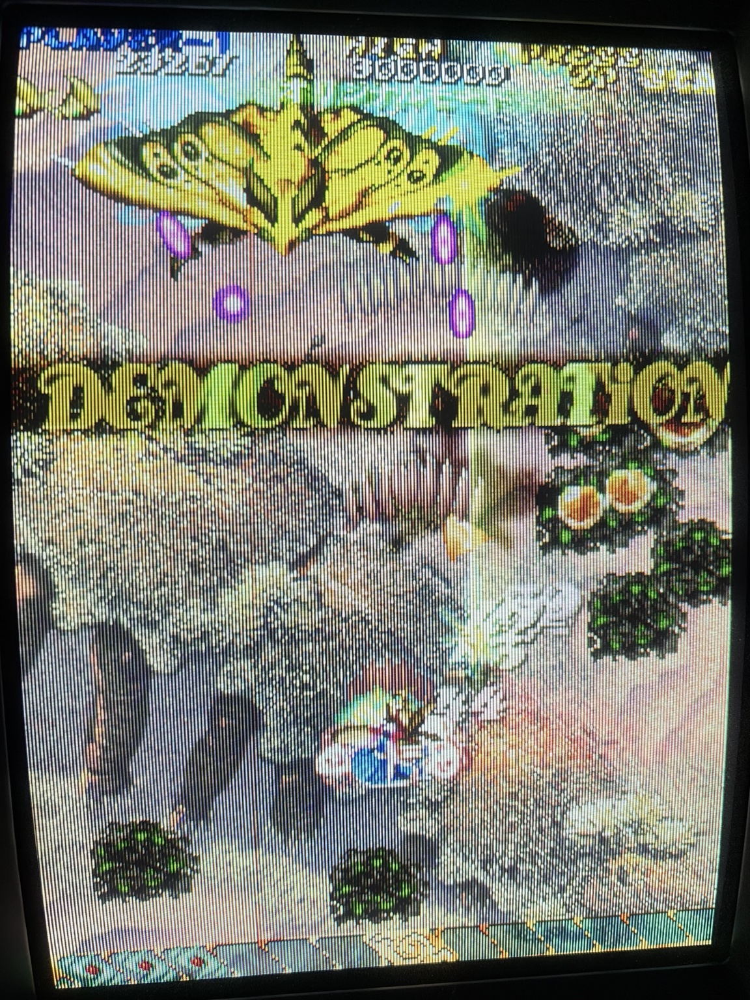
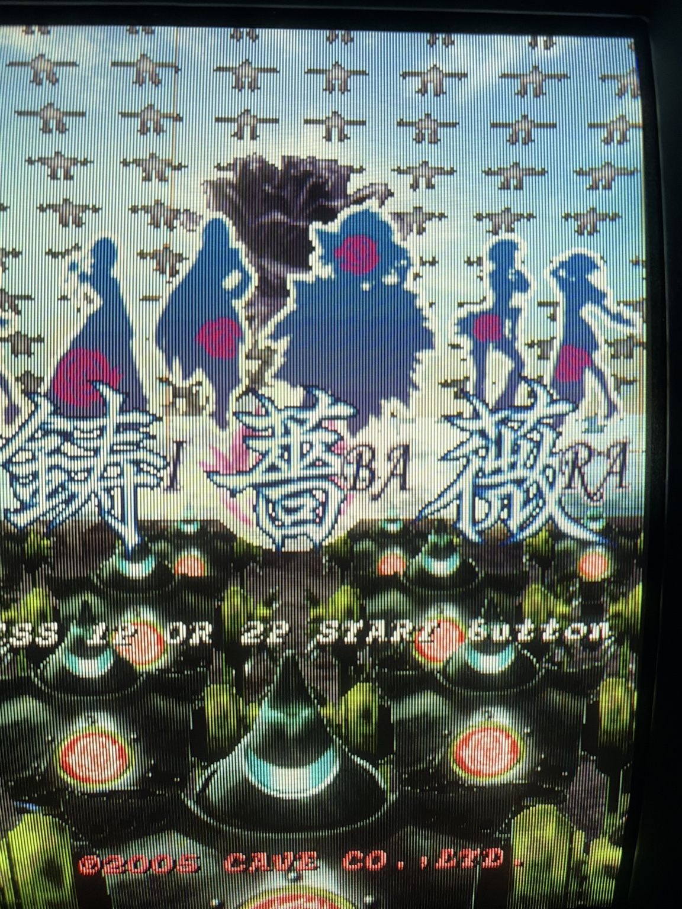
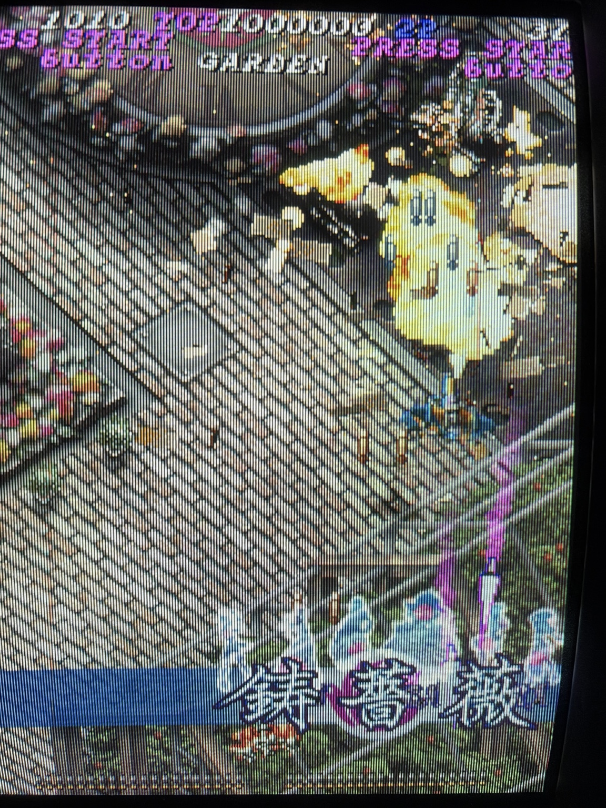

# Cave/Taito — Native 240p Patches (PS2: Ibara & Mushihimesama)

**Prerelease: `v0.1.0-beta.1`** · Japanese PlayStation 2 releases only · **Incomplete image / remaining shimmer — read Known limitations**

Patches the PlayStation 2 releases of **Ibara** (`SLPM-66301`) and **Mushihimesama** (`SLPM-66056`) to output a progressive **224-line picture using 240p timing**, instead of the original interlaced output. The patcher creates new ISO files from your own original game dumps; it includes no game images or executables.

> **This is a beta.** Ibara still has minor shimmer. Mushihimesama has a sharper, seemingly shimmer-free 2× gameplay image, but the edges are cropped. Neither patch is a full-frame 240-line restoration.


## Why this project exists

The goal is to bring Taito's PlayStation 2 ports of Cave's **Ibara** and **Mushihimesama** closer to the CRT-friendly presentation of **Arika's Cave PS2 ports**, including *DoDonPachi DaiOuJou* and *Espgaluda*. Those Arika releases provide a useful benchmark for presenting arcade-era pixel art on a CRT.

The Taito releases have their own worthwhile **PS2-specific options and modes**, but their interlaced output and image processing can compromise the arcade-style presentation. This project aims to let CRT owners enjoy those extra options with **progressive, sharper, more arcade-accurate video**. **Parity is the goal, not a claim about this beta:** both games still crop some picture information, and Ibara has residual shimmer.

## Photos — Sony PVM-14M4U

These are **off-screen photographs of a Sony PVM-14M4U CRT**, not direct PCSX2 screenshots. They show the current prerelease presentation; CRT scanlines, camera exposure and moiré are visible in the photos and are not necessarily in-game artifacts.

| Mushihimesama — demonstration | Ibara — title screen | Ibara — gameplay |
|:--:|:--:|:--:|
|  |  |  |

## Requirements

- Python **3.8+** (no packages to install)
- One or both of your **unmodified Japanese game ISOs**, using 2048-byte-sector ISO9660 format
- PCSX2 or a PS2 setup that can run your own backups, and a display/scaler that accepts 240p

## Installation / Usage

The patcher works on **Windows, macOS, and Linux** using Python **3.8 or newer**; it needs no additional Python packages. Use **original, unmodified Japanese ISO dumps**.

1. Download the repository ZIP from GitHub (**Code → Download ZIP**) and extract it to a folder, such as `cave-ps2-240p` in Downloads. Alternatively, clone the repository with Git.
2. Place one or both original ISO files **in that same folder as `cave_ps2_progressive.py`**, named exactly:
   - `Ibara (Japan).iso`
   - `Mushihimesama (Japan).iso`
3. Follow the instructions for your operating system below. The script patches whichever of the two ISOs it finds, or both if both are present.

### Windows (PowerShell)

Install Python 3 from [python.org](https://www.python.org/downloads/windows/) if needed. Open the extracted `cave-ps2-240p` folder in File Explorer, then **right-click an empty area → Open in Terminal** (or open PowerShell and navigate to the folder):

```powershell
cd "$HOME\Downloads\cave-ps2-240p"
py -3 --version
py -3 cave_ps2_progressive.py
```

If you installed Python without the `py` launcher, try `python cave_ps2_progressive.py` instead. If Windows opens the Microsoft Store or says Python is not recognized, install Python and reopen Terminal. **Do not double-click the `.py` file**; run it from the terminal to see validation messages.

### macOS (Terminal)

Open Terminal and run:

```bash
cd ~/Downloads/cave-ps2-240p
python3 --version
python3 cave_ps2_progressive.py
```

If `python3` is not found, install Python 3 from [python.org](https://www.python.org/downloads/macos/) and reopen Terminal.

### Linux (Terminal)

Open a terminal and run:

```bash
cd ~/Downloads/cave-ps2-240p
python3 --version
python3 cave_ps2_progressive.py
```

If Python 3 is missing, install it with your distribution's package manager (for example, `sudo apt install python3` on Debian/Ubuntu). Run the script using `python3`; it does not need `sudo` or an executable bit.

**On all systems:** Your original ISO files are left untouched. Ensure you have enough free disk space for a separate copy of each ISO. If the files are in another directory, specify their paths or use `--input-dir` (see below).

### Output files

```text
SLPM_663.01.Ibara (240p v0.1.0-beta.1).iso
SLPM_660.56.Mushihimesama (240p v0.1.0-beta.1).iso
```

### Other commands

On **macOS and Linux**, use `python3` as shown below. On **Windows**, replace `python3` with `py -3` (or `python` if `py` is unavailable). Quote filenames and folder paths containing spaces.

Patch just one ISO (the input can have any filename):

```bash
python3 cave_ps2_progressive.py "Ibara (Japan).iso"
python3 cave_ps2_progressive.py "Mushihimesama (Japan).iso"
```

Check compatibility without creating an ISO:

```bash
python3 cave_ps2_progressive.py --dry-run
```

Search for the default input filenames in another directory:

```bash
# macOS / Linux
python3 cave_ps2_progressive.py --input-dir "$HOME/Downloads/Ibara Patches"
```

```powershell
# Windows PowerShell
py -3 cave_ps2_progressive.py --input-dir "$HOME\Downloads\Ibara Patches"
```

Output files are written alongside their source ISOs by default. Use `--output-dir PATH` to choose another directory. The patcher refuses to overwrite an existing output and rejects unsupported or modified executables.

## Known limitations

| Game | Image crop | Other known issues |
|---|---|---|
| **Ibara** | Original 240-line source is cropped to 224 lines: **8 source lines removed at each edge** (16 total). | **Minor residual vertical/diagonal shimmer**, including the **water shimmer** seen during scrolling. Field-state and half-pixel tweaks are not a complete fix. |
| **Mushihimesama** | **224 of 240 source lines shown** (16 total lost). The **Center 12** profile is offset: approximately **3 lines from the starting edge and 13 from the opposite edge**, rather than a symmetrical crop. | Part of the gameplay picture is missing. Full 240-line expansion is **not** included. **No sound over optical S/PDIF:** the original PS2 release also lacks optical audio support in our testing; this is not caused by the patch. Use **analog stereo RCA** outputs. A future optical-audio compatibility fix is planned for investigation. |

Cropping above is expressed along the image's source vertical coordinate, **not necessarily the left/right edges of a physically rotated TATE monitor**. These estimates concern the game's graphic source and can differ by about a pixel with subpixel alignment. Both game outputs use 224 active picture lines with 240p-style video timing.

**Testing:** The Ibara and Mushihimesama patches were investigated in PCSX2, including GS dumps; not all game modes, hardware revisions, and CRT configurations have been verified. Treat this as experimental on original hardware; report any mode switches, freezes, audio problems or video corruption. See [docs/TESTING.md](docs/TESTING.md).

## FAQ

**Why does the water still shimmer in Ibara?**  
The patch removes the most obvious interlacing and final-pass scaling artifacts, but **Ibara's water still shimmers** during motion. That is a known unresolved rendering issue, and eliminating it requires further reverse-engineering and hardware comparison. This prerelease is not a claim of perfect arcade pixel alignment.

**Why is there no sound in Mushihimesama?**  
On the original PS2 release, **optical (TOSLINK/S/PDIF) output does not produce sound** in the tested setup, even with an unpatched ISO. This is a native game compatibility limitation, **not a regression introduced by the 240p patch**. For now, connect the PS2's **red/white analog stereo outputs**. An optical-audio fix is **planned for investigation in a future version**, but is not available or guaranteed in this prerelease.

**Is this already fully arcade-accurate?**  
Not yet. The goal is presentation closer to Arika's Cave PS2 ports while retaining Taito's PS2-specific options. This beta outputs a progressive 224-line picture, **not all 240 source-image rows**. Ibara removes 8 lines at each edge; Mushihimesama's tested Center 12 position hides approximately 3 from one edge and 13 from the other. Full-frame restoration and further shimmer fixes are still in development.

**Do I need to change audio settings for the patch?**  
The patcher does not modify game audio. For Mushihimesama on original hardware, use analog stereo audio; switching to optical alone will not restore sound.

## Documentation

- [docs/HOW_IT_WORKS.md](docs/HOW_IT_WORKS.md) — the two different rendering problems and approaches
- [docs/PATCH_SPEC.md](docs/PATCH_SPEC.md) — patch tables, ELF offset mapping and reference hashes
- [docs/INVESTIGATION.md](docs/INVESTIGATION.md) — what was tried, what failed, and what remains
- [docs/TESTING.md](docs/TESTING.md) — test status and how to submit useful reports
- [CHANGELOG.md](CHANGELOG.md) — prerelease notes

## Verification

The script verifies the original Japanese executable's SHA-256 and each edited word, then checks the complete patched ELF against a known reference SHA-256 before writing. Afterward, it reads the patched ELF back from the output ISO. To inspect a patched ISO again:

```bash
# macOS / Linux
python3 tools/verify_patch.py "SLPM_663.01.Ibara (240p v0.1.0-beta.1).iso"
```

```powershell
# Windows PowerShell
py -3 tools\verify_patch.py "SLPM_663.01.Ibara (240p v0.1.0-beta.1).iso"
```

You can give `verify_patch.py` either output ISO.

## Related project

- [Psikyo Shooting Collection Vol. 3 — Native 240p Patch](https://github.com/calcification/psikyo-ps2-240p)

## Legal

No copyrighted game data is provided. This project is not affiliated with Cave, Taito, Sony, or any other rights holder. Use only with game images you are entitled to use. The patcher itself is distributed under the [MIT license](LICENSE), as-is and without warranty.
